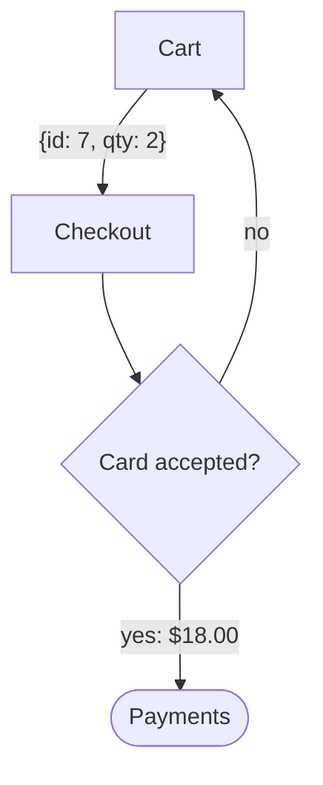

# Explain change

Teach one code change well enough that the reader could review it. In Claude Code with the `explain-change` mod installed, the lesson shows in its pane; everywhere else it goes in chat.

## 1. Pin the change

The argument names it: a PR (`gh pr diff <number>`), a branch or ref range, a commit, or uncommitted work. With no argument, take the current branch against its merge base with the default branch, plus uncommitted changes.

List every file the change touches first (`git diff --stat`, `git show --stat`, or the PR's file list): that list is the walkthrough's checklist. Then read the whole diff, file by file, and the code around each hunk: callers, types, tests. Done when you can say what the system did before and after, and every file on the list, migrations, moves, and deletions included, has a place in that story.

## 2. Write the lesson

Four parts, each markdown rendered the way an assistant reply is:

- **background**: the existing system the change lives in. Open with a deep background for newcomers, marked as skippable for readers who know the code, then narrow to the part the change touches.
- **intuition**: the essence of the change, not its details. Walk a concrete example with toy data through the before and the after.
- **code**: a walkthrough of every file on the checklist, grouped and ordered so each group builds on the last. A schema migration, code moved to a new module, or a deleted file each gets its own sentence, since a reviewer misses those first. Cite files as `path:line` only for lines you read in the diff. Resolve citation paths against the repository containing that diff (`git rev-parse --show-toplevel` from the change's directory). Before showing the lesson, check that every link target identifies that checklist file and a line read in its diff, including when the change lives in a nested repository.
- **quiz**: five medium questions that take the substance of the change to answer, not gotchas. Each has three or four options, exactly one correct and shuffled so its letter changes from question to question, and every option carries feedback saying why it is right or wrong.

Write in classic style, with the clarity and flow of Martin Kleppmann; transitions carry the reader from one part into the next. Set key concepts, definitions, and edge cases apart as callouts: a blockquote led by a bold label (`> **Edge case:** ...`).

### Diagrams

Draw flows between components or steps as a `mermaid` flowchart: the pane lays it out to fit its width, and chat shows the source. Draw every other diagram as text in a `text` fence, or a `diff` fence when it shows a change, at most 60 columns wide. Quote real source in a fence named for its language (`ts`, `css`, `sql`), so it is highlighted. Choose a few diagram families and reuse them across the parts, so the reader learns each one once. Use the smallest view that makes the point, and place it beside the sentence it supports:

- logic or an algorithm: pseudocode
- runtime control flow: a call tree
- UI structure: a component tree with the state and module boundaries that matter, or a simplified sketch of the screen
- file responsibilities: a shallow file tree, one comment per entry
- components talking, or steps and decisions: a `flowchart TD` with `[box]`, `(round)`, and `{decision}` nodes, edges labelled with example data



To show what the change does to any of these shapes, draw the same shape as a `diff`:

```diff
 submitForm
   createSession
     persistPrompt
+    expandSkillMention
     launchAgent
```

Show a whole block instead when most of it is new, or when cutting context would hide ownership or order.

## 3. Show it

Where the `mcp__explain-change__show` tool exists (Claude Code with the `explain-change` mod), load it with ToolSearch (`select:mcp__explain-change__show`) and call it with `title`, a one-sentence `summary`, `background`, `intuition`, `code`, and `quiz`. A denial names the field to fix: fix it and call again. Then reply in one line saying what the change does, and pass on the tool's result.

Everywhere else, write the four parts in chat. Gather the quiz answers after the last question, so the reader can try the quiz before reading why, with a line for every option, the wrong ones too:

```markdown
1. **b** is right: <why b holds>.
   - a: <why a is wrong>
   - c: <why c is wrong>
```
