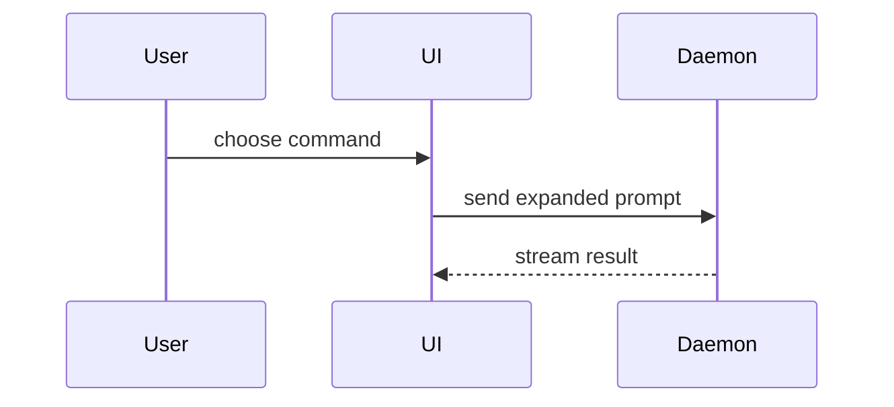

Use this template for writing the PR body:

```markdown
<opener>

<optional: screenshot or short output>

<details>
<summary><model name and effort level></summary>

## Summary

<diagram, diff-sketch, or tree>

## Evidence

- **Before:** <screenshot/output/failing test run>
  **After:** <screenshot/output/passing test run>

## Merge Danger

**Door:** <one-way or two-way>

<optional: description>

**Blast Radius:** <one-word description>

<optional: potential ramifications of merge>

</details>
```

Keep the blank lines around `<summary>` and before `</details>`: GitHub renders Markdown inside `<details>` only with them.

## Sections

Skip all preambles and keep prose brief. Use the user's domain language from `GLOSSARY.md`.

### Opener

The shortest text that tells a reviewer what the PR is for and whether it deserves more of their attention: one to three sentences in plain words, naming the problem and the outcome. A visual change gets one screenshot below it; a new command can get its `--help` output. Everything else goes in the collapsed details.

Write it last, from the sections below. Quote it in your reply to the user so they can rewrite it: it stands for their judgement of what is worth a reviewer's time.

### Details summary

Your model name and effort level, as in `Claude Opus 5.5 Medium`, so the reader knows an agent wrote what it hides. Drop the effort level when you cannot find it.

### Summary

Pick the smallest view that makes the key point clear.

- Show logic or an algorithm as pseudocode:

```text
on(save)
  if content is unchanged
    return cached result
  write new content
  return fresh result
```

- Show runtime control flow as a call tree:

```text
submitForm
  createSession
    persistPrompt
    launchAgent
  navigateToSession
```

- Show UI structure as a component tree, including state and module boundaries that matter:

```text
<SessionPage> (apps/example/src/routes/session.tsx)
  useSessionEvents()
  <SessionToolbar>
    <RunSkillButton> (packages/ui)
```

- Show file responsibility or a broad refactor as a shallow file tree:

```text
src/
├── commands/       # parses user actions
├── sessions/       # owns session state
└── transport/      # sends API requests
```

- Show component interaction, control flow, or data flow with Mermaid:



- Use `diff` when the point is what changes and the surrounding shape already exists. Diff the same shape you would draw: component tree, file tree, call tree, or pseudocode.

For a component change:

```diff
 <SessionPage>
   useSessionEvents()
   <SessionToolbar>
+    <RunSkillButton />
   <SessionTimeline>
+    <SkillResultCard />
```

For a file-layout change:

```diff
 src/
 ├── commands/
+│   └── show-me.ts       # expands the slash command
 ├── sessions/
-└── transport.ts
+└── transport/
+    ├── client.ts
+    └── stream.ts
```

- Show the whole block when most of it is new, when omitted context would hide ownership or order, or when the user needs a copyable target shape:

```ts
function expandSkill(command: string): string {
  const skillName = command.slice(1);
  return "use the " + skillName + " skill";
}
```

#### Guidance

Place each visual next to the short text it supports. Keep only the calls, files, props, states, and boundaries the reader needs to grasp the change. Use one visual or a few; most changes need one.

### Evidence

Concrete before and after evidence that the change works.

- S-tier: screenshots, when the environment supports them and the change is visual.
- A-tier: execution output, test results, console output. Show the exact test that failed and now passes, as pseudocode.

### Merge Danger

Door: a two-way door can be walked back; a one-way door cannot. Destructive actions and hard-to-reverse decisions are one-way; a PR cheap to roll back is lower risk.

Blast radius: the scope of what the merge can affect, such as layout shift, breakage for consumers, or mobile responsiveness.
